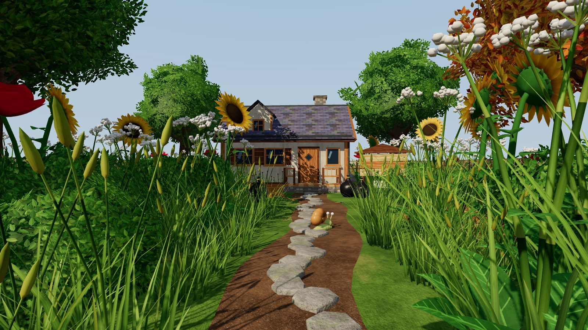
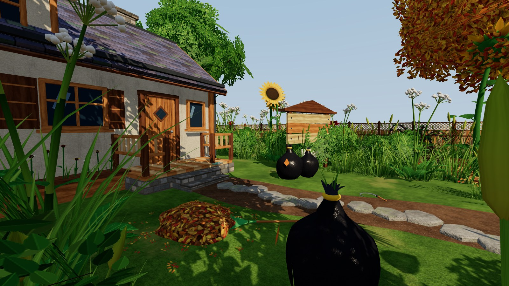
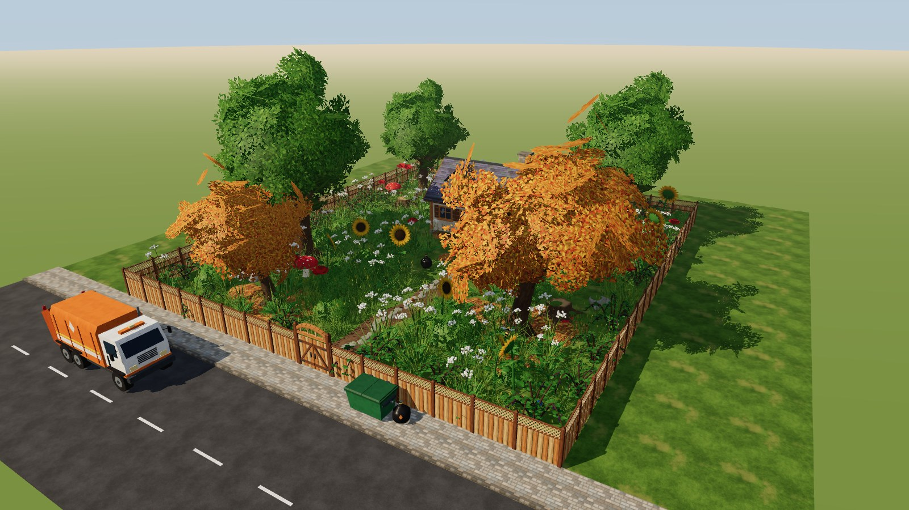
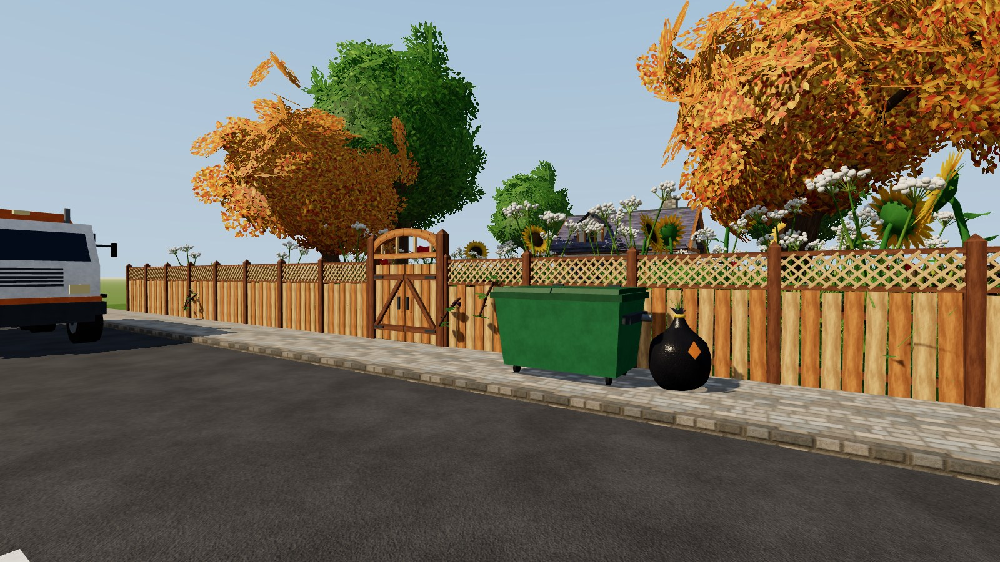
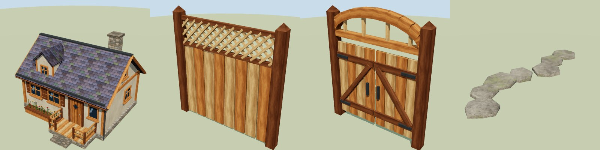
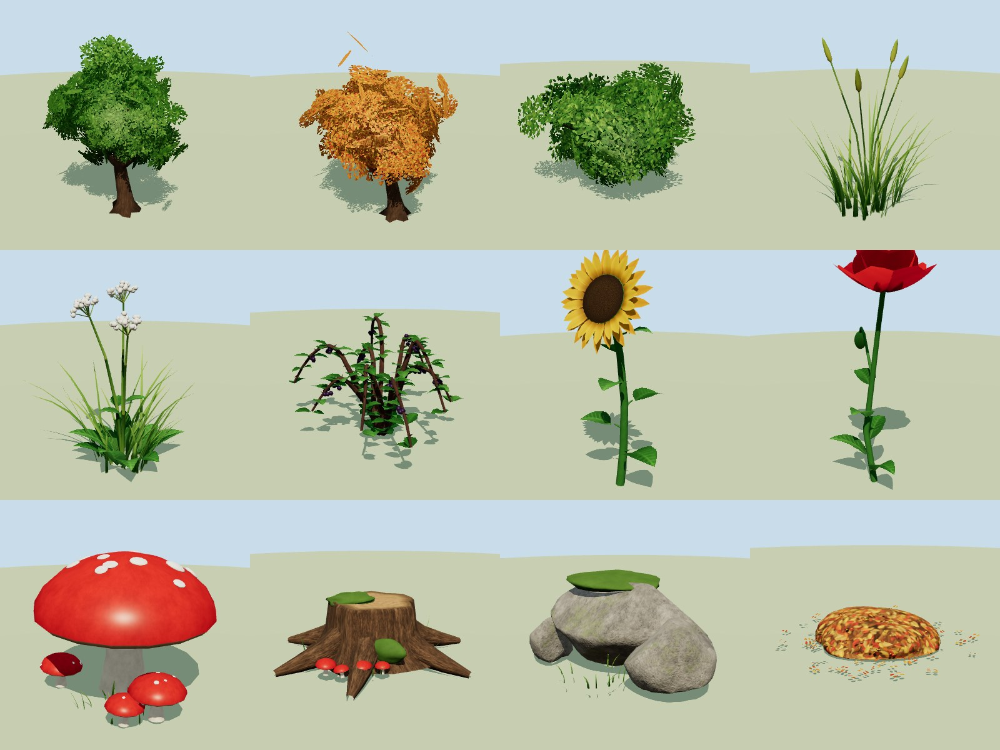
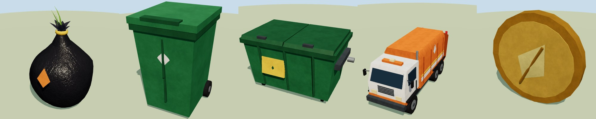
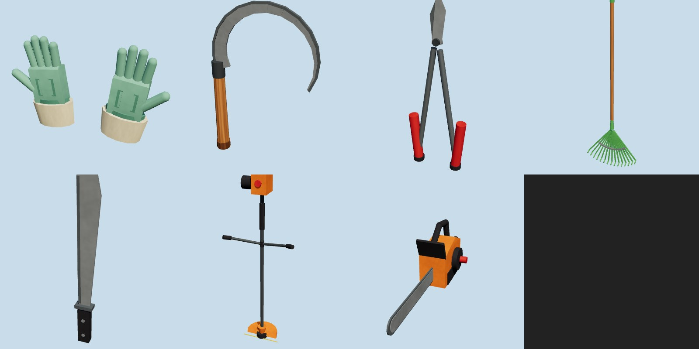
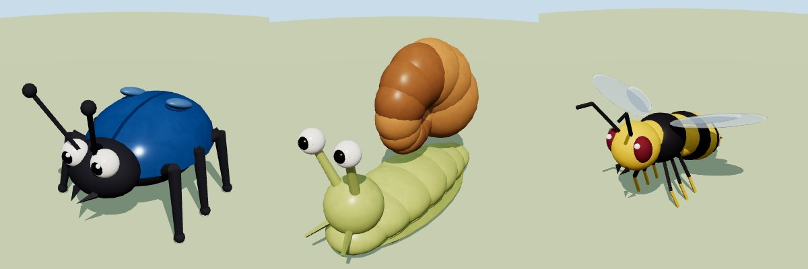
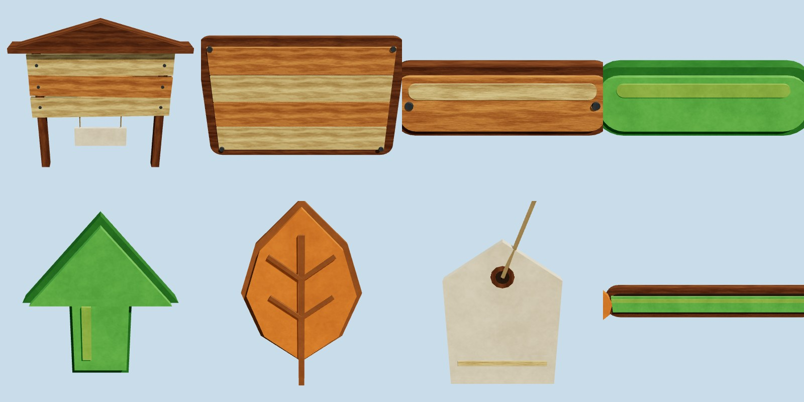

# Jugo 🌿

Juego incremental en Godot 4: llegas a una casa con un jardín abandonado y salvaje
(árboles gigantes, hierbajos enormes, zarzas, setas, bichos...). Lo vas despejando,
metes la vegetación en bolsas, las tiras al contenedor y, cuando se llena, llega el
camión de la basura y te paga. Con ese dinero compras mejores herramientas que te
dejan romper elementos más duros, abrir zonas nuevas y acabar con bichos más fuertes.

## Estado actual

- **Escena principal** (`escenas/principal.tscn`): la casa, la parcela vallada con su puerta,
  el jardín salvaje (unas 600 piezas colocadas por código), la calle con el contenedor y el
  camión, y un jugador en primera persona para recorrerlo.
- **42 modelos 3D** con texturas (madera, estuco, tejas, piedra, corteza, hojas con
  transparencia...), sombreado suave y mapas de normales.
- **Galería** (`escenas/galeria.tscn`) para ver cada modelo por separado.

| | |
|---|---|
|  |  |
|  |  |

Las capturas están hechas con un visor glTF (three.js), no con Godot: la luz y el cielo
de Godot serán algo distintos.

| Entorno | Vegetación |
|---|---|
|  |  |
| **Jugabilidad** | **Herramientas** |
|  |  |
| **Bichos** | **UI en 3D** |
|  |  |

## Cómo abrirlo

1. Abre Godot 4.3 o superior → *Importar* → elige `project.godot` (la primera importación
   tarda un poco).
2. Dale a ▶. Se abre la escena principal.
   - WASD: moverse · Ratón: mirar · Shift: correr · Espacio: saltar · Esc: soltar el ratón.
3. Para ver los modelos sueltos, abre `escenas/galeria.tscn` y pulsa F6.
   - Clic derecho + arrastrar: girar · Rueda: zoom · WASD / Q E: moverse.

## Estructura

```
assets/modelos/*.gltf      los modelos (indice.json dice la categoría y el tamaño de cada uno)
  entorno:       casa, valla, puerta_jardin, parcela, suelo_cesped, camino_piedra
  vegetación:    arbol_gigante, arbol_otono, hierbajo, hierbajo_grande, matorral, zarza,
                 girasol_gigante, amapola_gigante, seta_gigante, tocon, roca,
                 monton_hojas, alfombra_hojas
  jugabilidad:   bolsa_basura, cubo_basura, contenedor, camion_basura, moneda
  herramientas:  guantes, hoz, tijeras_podar, rastrillo, machete, desbrozadora, motosierra
  bichos:        escarabajo, caracol, avispa
  ui:            cartel_tienda, panel_madera, boton_madera, boton_verde,
                 flecha_mejora, icono_hoja, etiqueta_precio, barra_progreso
assets/modelos/texturas/   texturas compartidas por todos los modelos
escenas/principal.tscn     escena principal del juego
escenas/galeria.tscn       escena de prueba con todos los modelos
scripts/jugador.gd         jugador en primera persona
scripts/camara_orbital.gd  cámara de la galería
herramientas_dev/          scripts en Python que generan texturas, modelos y escenas
docs/previews/             capturas
```

## Progresión propuesta (herramientas → qué rompen)

| Nivel | Herramienta | Despeja | Contra bichos |
|---|---|---|---|
| 0 | Guantes | hierbajo pequeño, montón de hojas | — |
| 1 | Rastrillo | montones de hojas grandes y rápido | — |
| 2 | Hoz | hierbajo grande, flores gigantes | caracol |
| 3 | Tijeras de podar | matorral, setas | escarabajo |
| 4 | Machete | zarza | avispa |
| 5 | Desbrozadora | todo lo verde en área | todos (área) |
| 6 | Motosierra | tocones y árboles gigantes | — |

El bucle sería: despejar → la vegetación llena tu bolsa → bolsa al contenedor →
contenedor lleno = llega el `camion_basura`, levanta el contenedor con su `brazo` y
te paga en `moneda` → compras en el `cartel_tienda` → la barra de zona
(`barra_progreso`) marca cuánto llevas de cada parte del jardín.

## Convenciones de los modelos

- Unidades en metros, **Y hacia arriba**, el frente mira a **+Z**.
- Origen en la base (en el suelo). Herramientas: origen en el agarre. UI: origen en el centro.
- Las piezas animables son **nodos hijos con el origen en su punto de giro**:
  - `camion_basura`: `rueda_*` (giran en X), `brazo` (elevador trasero).
  - `contenedor`: `tapa_izq`, `tapa_der` (bisagra atrás), `rueda_*`.
  - `cubo_basura`: `tapa`, `rueda_izq`, `rueda_der`.
  - `puerta_jardin`: `hoja_izq`, `hoja_der` (bisagras en los postes).
  - `escarabajo`: `pata_izq_1..3`, `pata_der_1..3`. `avispa`: `ala_izq`, `ala_der`.
  - `guantes`: `guante_izq`, `guante_der`.
  - `barra_progreso`: `relleno` tiene el origen a la izquierda → `scale.x` de 0 a 1 = progreso.
- Los materiales (`madera`, `estuco`, `tejado`, `hojas_verde`...) usan las texturas de
  `assets/modelos/texturas` teñidas con una paleta común. Godot los importa como `StandardMaterial3D`.
- Las hojas y la hierba llevan las dos caras en la geometría (con las mismas normales), para
  que se iluminen igual por delante y por detrás.
- **UI en 3D**: para usarlas en el HUD 2D, ponlas en un `SubViewport` con su cámara y usa
  un `ViewportTexture` en un `TextureRect` (o rénderízalas una vez a PNG como iconos).

## Regenerar o modificar

Todo sale de código, así que se puede cambiar y regenerar en segundos:

```bash
pip install trimesh numpy scipy pillow
python3 herramientas_dev/generar_texturas.py              # texturas
python3 herramientas_dev/generar_modelos.py               # todos los modelos
python3 herramientas_dev/generar_modelos.py casa zarza    # solo algunos
python3 herramientas_dev/generar_escena.py                # escena principal
python3 herramientas_dev/generar_galeria.py               # galería
```

- Colores: `PALETA` al principio de `generar_modelos.py`. Materiales y texturas: `MATS`.
- Densidad y colocación del jardín: función `componer()` de `generar_escena.py`
  (cantidades de cada planta, árboles, zona despejada, semilla aleatoria).
- Si retocas `principal.tscn` a mano en Godot, no vuelvas a ejecutar `generar_escena.py`
  o perderás los cambios (o guarda tu versión con otro nombre).
