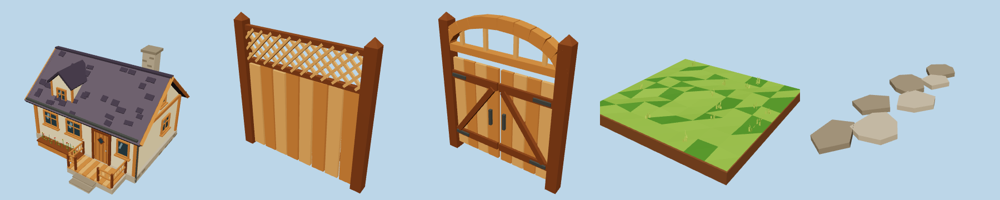
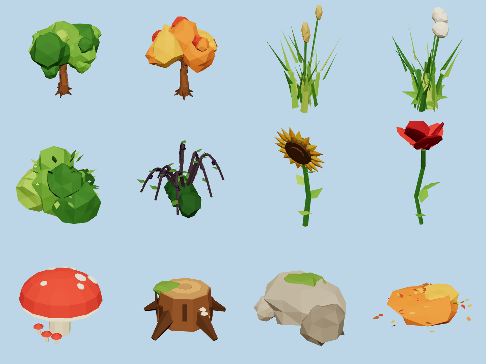
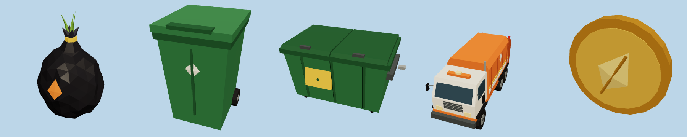
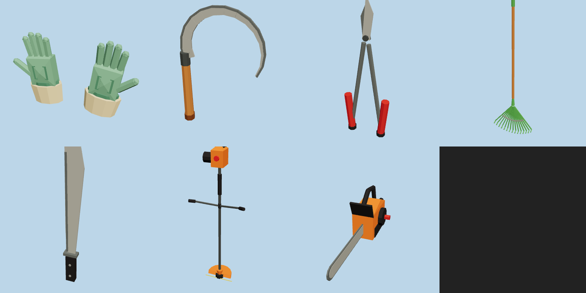
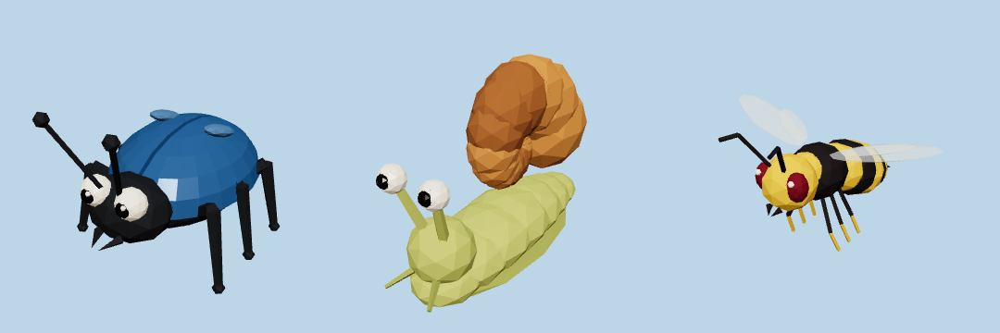
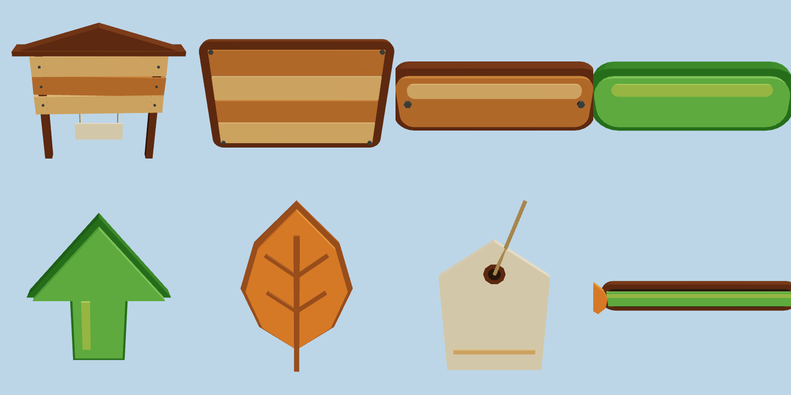

# Jugo 🌿

Juego incremental en Godot 4: llegas a una casa con un jardín abandonado y salvaje
(árboles gigantes, hierbajos enormes, zarzas, setas, bichos...). Lo vas despejando,
metes la vegetación en bolsas, las tiras al contenedor y, cuando se llena, llega el
camión de la basura y te paga. Con ese dinero compras mejores herramientas que te
dejan romper elementos más duros, abrir zonas nuevas y acabar con bichos más fuertes.

## Estado actual

Primera tanda de **40 modelos 3D low-poly** (sombreado plano, paleta otoñal y cálida)
y un proyecto de Godot con una **galería** para verlos todos.

| Entorno | Vegetación |
|---|---|
|  |  |
| **Jugabilidad** | **Herramientas** |
|  |  |
| **Bichos** | **UI en 3D** |
|  |  |

## Cómo abrirlo

1. Abre Godot 4.3 o superior → *Importar* → elige `project.godot`.
2. Dale a ▶. Se abre `escenas/galeria.tscn`.
   - Clic derecho + arrastrar: girar · Rueda: zoom · WASD / Q E: moverse · Shift: más rápido.

## Estructura

```
assets/modelos/
  entorno/        casa, valla, puerta_jardin, suelo_cesped, camino_piedra
  vegetacion/     arbol_gigante, arbol_otono, hierbajo, hierbajo_grande, matorral,
                  zarza, girasol_gigante, amapola_gigante, seta_gigante, tocon,
                  roca, monton_hojas
  jugabilidad/    bolsa_basura, cubo_basura, contenedor, camion_basura, moneda
  herramientas/   guantes, hoz, tijeras_podar, rastrillo, machete, desbrozadora, motosierra
  enemigos/       escarabajo, caracol, avispa
  ui/             cartel_tienda, panel_madera, boton_madera, boton_verde,
                  flecha_mejora, icono_hoja, etiqueta_precio, barra_progreso
escenas/galeria.tscn       escena de prueba con todos los modelos
scripts/camara_orbital.gd  cámara de la galería
herramientas_dev/          scripts en Python que generan los modelos y la galería
docs/previews/             capturas de los modelos
```

## Progresión propuesta (herramientas → qué rompen)

| Nivel | Herramienta | Despeja | Contra bichos |
|---|---|---|---|
| 0 | Guantes | hierbajo pequeño, montón de hojas | — |
| 1 | Rastrillo | montones de hojas grandes y rápido | — |
| 2 | Hoz | hierbajo grande, flores gigantes | caracol |
| 3 | Tijeras de podar | matorral, setas | escarabajo |
| 4 | Machete | zarza | avispa |
| 5 | Desbrozadora | todo lo verde en área | todos (área) |
| 6 | Motosierra | tocones y árboles gigantes | — |

El bucle sería: despejar → la vegetación llena tu bolsa → bolsa al contenedor →
contenedor lleno = llega el `camion_basura`, levanta el contenedor con su `brazo` y
te paga en `moneda` → compras en el `cartel_tienda` → la barra de zona
(`barra_progreso`) marca cuánto llevas de cada parte del jardín.

## Convenciones de los modelos

- Unidades en metros, **Y hacia arriba**, el frente mira a **+Z**.
- Origen en la base (en el suelo). Herramientas: origen en el agarre. UI: origen en el centro.
- Las piezas animables son **nodos hijos con el origen en su punto de giro**:
  - `camion_basura`: `rueda_*` (giran en X), `brazo` (elevador trasero).
  - `contenedor`: `tapa_izq`, `tapa_der` (bisagra atrás), `rueda_*`.
  - `cubo_basura`: `tapa`, `rueda_izq`, `rueda_der`.
  - `puerta_jardin`: `hoja_izq`, `hoja_der` (bisagras en los postes).
  - `escarabajo`: `pata_izq_1..3`, `pata_der_1..3`. `avispa`: `ala_izq`, `ala_der`.
  - `guantes`: `guante_izq`, `guante_der`.
  - `barra_progreso`: `relleno` tiene el origen a la izquierda → `scale.x` de 0 a 1 = progreso.
- Los materiales van por color (`hoja`, `madera`, `tejado`...) con colores sacados de una
  paleta común, así todo combina. Godot los importa como `StandardMaterial3D`.
- **UI en 3D**: para usarlas en el HUD 2D, ponlas en un `SubViewport` con su cámara y usa
  un `ViewportTexture` en un `TextureRect` (o rénderízalas una vez a PNG como iconos).

## Regenerar o modificar los modelos

Los modelos salen de código (`herramientas_dev/generar_modelos.py`), así que se pueden
cambiar colores, tamaños o formas y regenerar:

```bash
pip install trimesh numpy scipy
python3 herramientas_dev/generar_modelos.py               # todos
python3 herramientas_dev/generar_modelos.py casa zarza    # solo algunos
python3 herramientas_dev/generar_galeria.py               # rehace la galería
```

La paleta está al principio del script (`PALETA`): cambiar un color ahí lo cambia en
todos los modelos que lo usan.
